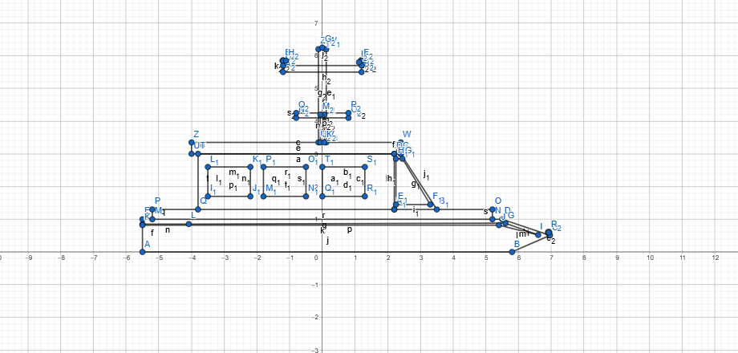
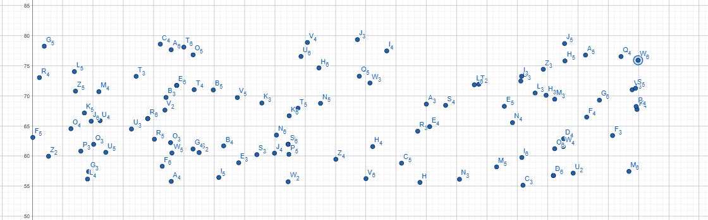
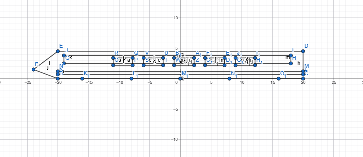
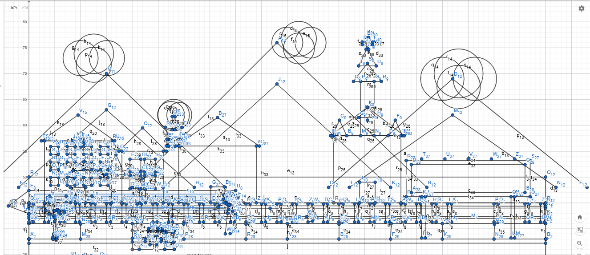
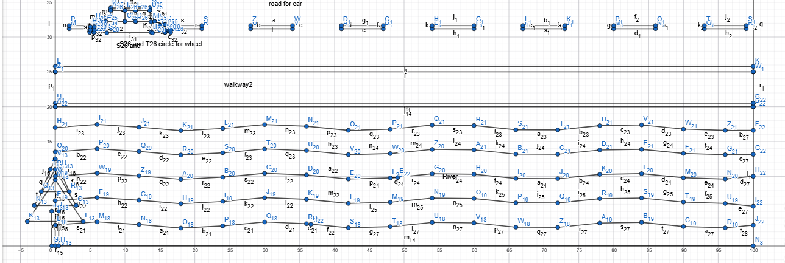

 # A Modern City View

## Introduction

This project is an animated 2D City View built using **C++** and **OpenGL/GLUT**, featuring switchable day and night scenes (toggled via mouse click). The scene includes a sky, sun and moon, stars, drifting clouds, mountains, buildings, a river with a boat, trees, a road with moving cars and an ambulance, a train on a railroad, a rising balloon, a keyboard-controllable airplane, and rain in day and night.

---

## Scene 2: A Modern City View

**Objects:**
`drawSky`, `drawSun`, `drawMoon`, `drawStars`, `drawCloud` (cloud1, cloud2, cloud3), `drawBackgroundMountains` (3), `drawRain`, `drawRoad`, `drawRailRoad`, `drawStreetLamp`, `drawCar`, `drawAmbulance`, `drawModernTrain`, `drawBoat`, `drawPlane`, `drawHotAirBalloonDay`, `drawSmallTownHouse`, `drawHospital`, `drawSchool`, `drawChurch`, `drawBigPineTree`, `drawProTree`, `drawPalmTree`, `drawCherryTree`, `drawRiver`, `drawRoadBillboard`

**Animations:**
Cloud moving, Boat moving from both sides, car movement, Rain fall, day-night transition, Train moving, Hot air balloon movement from down to up, plane fly.

**Mouse Interaction:**
- Left click = Day
- Right click = Night

**Keyboard Interaction:**
- `R` / `r` = Rain starts
- `T` / `t` = Stop rain
- Arrow keys = Plane up / down, and right arrow to move forward
- `Home` = Re-center the plane in initial position

---

## Project Graph

---

## List of Objects Assigning an Object ID

| SL# | Object | Object ID |
| --- | --- | --- |
| 1 | Sky | s2 |
| 2 | Sun | s3 |
| 3 | Cloud 1 | s4 |
| 4 | Cloud 2 | s5 |
| 5 | Cloud 3 | s6 |
| 6 | Airplane | s7 |
| 7 | Car Road (Highway) | s8 |
| 8 | Ambulance | s9 |
| 9 | Railroad Track | s10 |
| 10 | Mountains | s11 |
| 11 | Big Pine Tree | s12 |
| 12 | Pro tree | s13 |
| 13 | Palm Tree | s14 |
| 14 | Cherry tree | s15 |
| 15 | Building Window | s17 - s28 |
| 16 | Hospital Building | s29 |
| 17 | School Building | s30 |
| 18 | Church Building | s31 |
| 19 | Small Town House | s32 |
| 20 | Hot Air Balloon | s34 |
| 21 | Street Lamp | s35 |
| 22 | Train | s37 |
| 23 | Car | s38 |
| 24 | River | S39 |
| 25 | Boat | s40 |
| 26 | Rain | s42 |
| 27 | Billboard | s43 |
| 28 | Stars | s45 |
| 29 | Moon | s46 |

---

## List of Functions To Represent Objects

| SL# | Object | Function Name | Object ID |
| --- | --- | --- | --- |
| 1 | Sky | `drawSky(bool night)` | s2 |
| 2 | Sun | `drawSun()` | s3 |
| 3 | Cloud 1 | `drawCloud1(float x, bool night)` | s4 |
| 4 | Cloud 2 | `drawCloud2(float x)` | s5 |
| 5 | Cloud 3 | `drawCloud3(float x, bool night)` | s6 |
| 6 | Airplane | `drawPlane(float Px, float Py, float scale)` | s7 |
| 7 | Car Road (Highway) | `drawCarRoad()` | s8 |
| 8 | Ambulance | `drawAmbulance()` | s9 |
| 9 | Railroad Track | `drawRailRoad()` | s10 |
| 10 | Mountains | `drawMountains(bool night)` | s11 |
| 11 | Big Pine Tree | `drawBigPineTree(float x, float y, bool night)` | s12 |
| 12 | Pro tree | `drawProTree(float x, float y, bool night)` | s13 |
| 13 | Palm Tree | `drawPalmTree(float x, float y)` | s14 |
| 14 | Cherry tree | `drawCherryTree(float x, float y)` | s15 |
| 15 | Building Window | `window1()` - `window12()` | s17 - s28 |
| 16 | Hospital Building | `drawHospital(bool night)` | s29 |
| 17 | School Building | `drawSchool(bool night)` | s30 |
| 18 | Church Building | `drawChurch(bool night)` | s31 |
| 19 | Small Town House | `drawSmallTownHouse(float x, float y, bool night)` | s32 |
| 20 | Hot Air Balloon | `drawHotAirBalloonDay()` | s34 |
| 21 | Street Lamp | `drawStreetLamp(float x, float y, bool night)` | s35 |
| 22 | Train | `drawModernTrain(float x, bool night)` | s37 |
| 23 | Car | `drawCar(float x, float y, float scale, float r, float g, float b, bool faceRight)` | s38 |
| 24 | River | `drawRiver(bool night)` | S39 |
| 25 | Boat | `drawBoat(float x, float y, float scale, float r, float g, float b)` | s40 |
| 26 | Rain | `drawRain()` | s42 |
| 27 | Billboard | `drawBillboard()` | s43 |
| 28 | Stars | `drawStars()` | s45 |
| 29 | Moon | `drawMoon(float x, float y, float r)` | s46 |

---

## List of Animation Functions with ID

| SL# | Animation Function | Object Applied On | Animation Function ID |
| --- | --- | --- | --- |
| 1 | `s_update()` | Cloud 1, Cloud 2, Cloud 3 - continuous horizontal drifting | s48 |
| 2 | `s_update()` | Car 1, Car 2, Car 3 - movement + wheel rotation | s48 |
| 3 | `s_update()` | Ambulance - movement along the road | s48 |
| 4 | `s_update()` | Train - movement along the rail track | s48 |
| 5 | `s_update()` | Boat 1, Boat 2, Boat 3 - movement along the river | s48 |
| 6 | `s_update()` | Hot Air Balloon - vertical up | s48 |
| 7 | `s_update()` | Rain fall | s48 |
| 8 | `s_handleSpecialKey()` | Airplane - Arrow keys move it; Home key resets position | S49 |
| 9 | `s_handleMouse()` | Scene (Day ↔ Night) - Left/Right click switches Scene 1 / Scene 2 | s51 |
| 10 | `s_handleKeypress()` | Rain / Weather - 'R' turns rain on, 'T' turns rain off | s52 |

---

## Contribution

| Member Name | Percentage of Contribution |
| --- | --- |
| Md. Salauddin Shaon | 25% |

---

## Conclusion

This project successfully demonstrates the use of C++ and OpenGL/GLUT to build a fully animated 2D city environment, combining some elements like sky, buildings, mountains, and rivers, real-time animations such as moving cars, trains, clouds, and weather effects. It highlights core computer graphics concepts including primitive shape rendering, coordinate transformations, double buffering, and user-interactive controls through keyboard and mouse input. Overall, the project reflects a solid practical understanding of real-time 2D graphics programming and interactive scene management using OpenGL.
